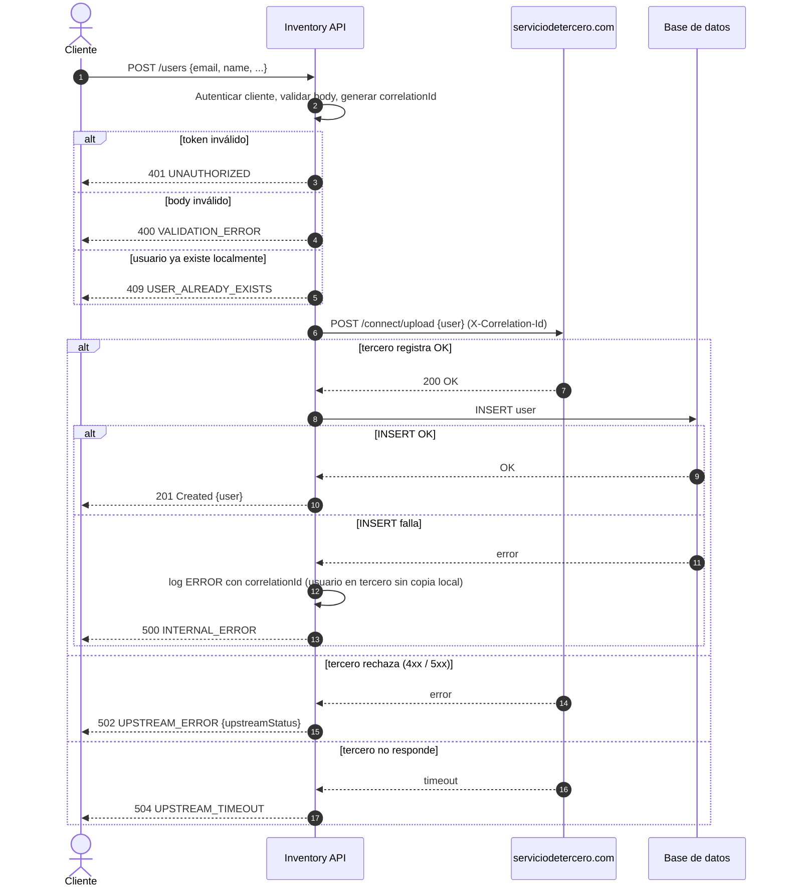
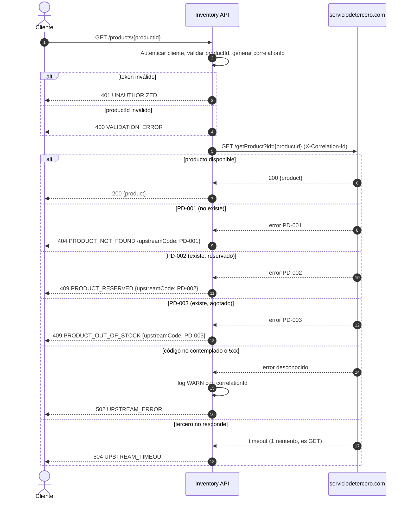
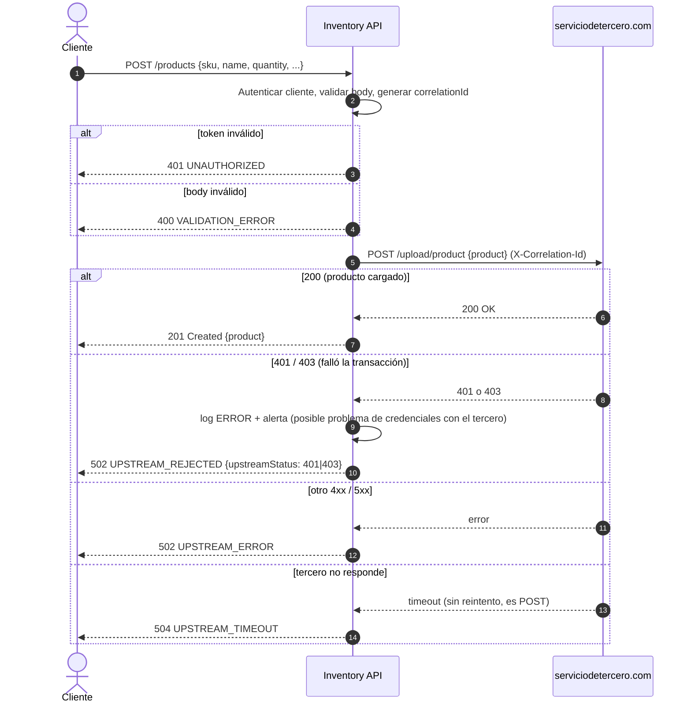

# DSS — Diagramas de Secuencia del Sistema

Un diagrama por función. Cada uno muestra todas las transacciones del flujo: la del cliente contra nuestra API, la de nuestra API contra el tercero y, cuando aplica, la persistencia local. Las ramas `alt` cubren cada código de respuesta que el enunciado define para el tercero, más los fallos de red que ningún contrato puede evitar.

Participantes:

| Participante | Rol |
|--------------|-----|
| **Cliente** | Quien consume nuestra API (front, otro servicio, integrador). |
| **Inventory API** | La API que diseñamos. Autentica al cliente, valida, orquesta y traduce errores. |
| **serviciodetercero.com** | El proveedor externo. Sus endpoints y códigos son los del enunciado. |
| **Base de datos** | Persistencia local. Solo interviene en el alta de usuario (ver supuestos en la documentación). |

## 1. Alta de usuario

## 2. Consultar producto

## 3. Cargar producto

## Convenciones de los diagramas

- `autonumber` numera cada transacción para poder referenciarla en la documentación y en los logs.
- Las ramas de autenticación y validación se dibujan una vez por diagrama; en la implementación son un middleware compartido.
- El `X-Correlation-Id` se genera en la API y se propaga al tercero en cada llamada. Es lo que permite seguir una transacción de punta a punta cuando algo falla.
- Los códigos de error de nuestra API (`PRODUCT_RESERVED`, `UPSTREAM_REJECTED`, etc.) y su justificación están en `documentacion-integracion.md`.
